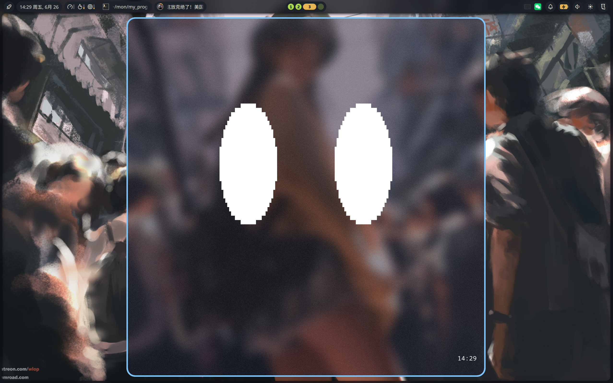

# Eyes · 终端里的陪伴双眼

**这是终端程序：直接在当前终端运行，不会新建图形窗口，也不需要桌面环境。**

画面只有两只眼睛，没有时钟、文字、状态栏、按钮、嘴、爱心或密纹填充。保留 2×4 Unicode 盲文点阵和实心块两种显示方式，也保留不眨眼、不闭眼的设定。



## 运行

需要 Rust 1.85+ 和支持 Unicode、ANSI 控制序列的交互式终端：

```bash
cargo run

# 不接管鼠标，使用键盘交互
cargo run -- --no-mouse

# 减少动态、纯白显示
cargo run -- --reduced-motion --mono

# 不进入动画，查看操作说明
cargo run -- --help
```

鼠标模式会接管当前终端的鼠标报告；想保留通常的选择/复制操作可使用 `--no-mouse`，或使用终端提供的 Shift 选择功能。退出时会恢复鼠标、焦点报告、光标、自动换行和主屏幕。

## 从“表情轮播”到“陪伴”

不再有随机数、动作队列、“过几秒换一个表情”或“按空格播放下一个表情”。关注、好奇、亲近、警觉与招呼的余韵，是根据交互持续变化、彼此混合的状态：

- **移动指针 / 按方向键**：目光平滑追随，左右眼略有不同，表现出好奇；交互停下后慢慢回到中间。
- **在眼睛附近轻柔移动或按住左键**：逐渐放松、轮廓变柔、微微靠近；亲近感会在本次运行中积累，不会松手就立刻消失。
- **单击 / 空格**：稍微睁大并上扬，以一个有余韵的小招呼回应，而不是切换表情。
- **Enter**：轻轻安抚一会儿；连续按或长按可持续安抚，是抚摸的键盘替代方式。
- **快速来回晃动**：略显警觉，上眼睑倾斜；停止后自然平静，不会一直生气。
- **终端失焦再回来**：先安静等待，重新获得焦点时有轻微的相见反应。终端需支持焦点报告；不支持时仍可使用鼠标和键盘。
- **什么也不做**：只有细微的呼吸感，不会随机乱看、突然换表情或因为你离开而哭泣。

双眼通过注视、倾斜、左右不对称、轮廓软硬、细微呼吸与淡冷暖来表达。眼睑只轻微改变上沿，始终保留睁开的眼睛，不再出现闭眼弧线。

这是纯本地数值情绪模型，不是聊天 AI，也不代表程序拥有真实情感。只使用本终端内的交互，不记录键盘文字、不监听其他程序、不访问摄像头、麦克风或网络。亲近感仅保存在内存里，退出即清空。

## 操作

这些说明只在 README 或 `--help` 中出现，不绘制到动画里。

| 操作 | 效果 |
| --- | --- |
| 鼠标移动 / 方向键 | 改变注视方向 |
| 眼睛附近轻柔移动 / 按住左键 | 抚摸、安抚 |
| 单击 / `Space` | 打招呼 |
| `Enter` | 安抚的键盘替代方式 |
| `B` | 盲文点阵 / 实心块 |
| `C` | 淡冷暖 / 纯白显示 |
| `M` | 开关减少动态效果 |
| `P` | 暂停 / 继续，暂停时仍可缩放和调整显示 |
| `Q` / `Esc` / `Ctrl+C` | 退出并恢复终端 |

设置 `NO_COLOR` 或使用 `--mono` 可关闭冷暖颜色。动画的几何变化独立于颜色，纯白模式也能交互。

盲文点距由终端字体决定，本程序不会用 `▓` 等纹理替换点阵；需要更紧凑的点距时应调整终端字号或字体。

## 实现与性能

- `src/animation.rs`：独立于 IO 的连续情绪模型。临界阻尼弹簧平滑混合交互产生的关注、好奇、亲近和警觉；输入中断、拖动或休眠恢复后不追赶历史动作。
- `src/render.rs`：只绘制两只眼睛，考虑字符格宽高比并按终端宽高共同约束布局；小终端退化为紧凑眼睛。复用双帧缓冲，合并变化区域并整帧批量输出；静止帧不输出，颜色做轻微量化以避免无意义重绘。
- `src/main.rs`：当前终端的鼠标、按键、焦点与缩放事件。活跃时目标 60 FPS，失焦、暂停或减少动态时为 30 FPS；合并输入批次，但不让输入洪流饿死动画或退出响应。
- 没有图形窗口库、桌面/GPU 依赖、图片解码、异步运行时或网络服务，唯一直接依赖为 `crossterm`。

日常 dev 构建只保留堆栈行号，依赖不生成调试信息，以控制 `target/` 占用。需要检查完整变量时使用 `cargo build --profile debugging`。

## 验证

```bash
cargo fmt --all -- --check
cargo check --locked
cargo test --locked
cargo clippy --locked --all-targets -- -D warnings

# Linux 伪终端集成检查：只需 Python 标准库，不使用图形环境
cargo build --locked
python3 tests/terminal_smoke.py

# 需要在交互式终端中运行，120 个动画帧后自动退出
cargo run -- --frames 120

# 手动测量两种显示模式在不同终端大小下的渲染开销
cargo test --locked measure_render_throughput -- --ignored --nocapture
```

测试覆盖连续情绪、全程睁眼、追踪与回正、抚摸与记忆、焦点重逢、键盘替代、减少动态、输入异常、极端终端比例、纯点阵、只画眼睛、差量输出、暂停、控制序列和 IO 错误。
